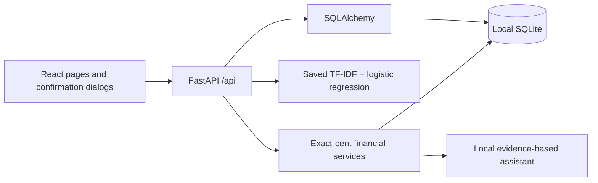

# Moniq architecture and integration boundaries

## Data path

Transactions use signed integer cents; frontend money values are derived backend outputs. Profile, account opening balance, transactions, category budgets, recurring/one-time schedules, goals, synthetic deals, imported notifications, and classification corrections have separate tables. Demo reset deterministically regenerates 90 days of records relative to today in America/New_York. Delete retains only an empty account marker to prevent automatic reseeding after restart.

## API map

| Purpose | Routes |
| --- | --- |
| Health, mode and dashboard | `GET /api/health`, `GET /api/config`, `GET /api/dashboard` |
| Transaction CRUD | `GET/POST /api/transactions`, `PUT/DELETE /api/transactions/{id}` |
| CSV | Local: `POST /api/imports/preview`, `POST /api/imports/csv` multipart file, mapping, sign convention, day-first. Public: `POST /api/demo/import-sample` server-owned synthetic CSV |
| ML | `POST /api/classify`, `GET /api/ml/metrics`, `POST /api/ml/retrain` |
| Alerts | `POST /api/notifications/parse`, `GET /api/notifications/examples` |
| Budgets | `GET/PUT /api/budgets` |
| Forecast/what-if | `GET /api/forecast`, `POST /api/scenarios` |
| Schedules | `GET/POST /api/schedules`, `PUT/DELETE /api/schedules/{id}` |
| Insights/offers | `GET /api/insights`, `GET /api/deals` |
| Subscription review | `GET /api/subscriptions`, `PUT /api/subscriptions/{id}` |
| Assistant | `POST /api/assistant` |
| Profile/goals | `GET/PUT /api/profile`, `GET /api/goals`, `PUT /api/goals/{id}` |
| Export/deletion/reset | `GET /api/export?format=json|csv`, `DELETE /api/data`, `POST /api/demo/reset` |

Pydantic validates requests. Financial helpers calculate before presentation. CSV imports validate all rows before writing; database uniqueness and normalized merchant/date/signed amount prevent duplicates. The duplicate heuristic can merge legitimately identical purchases and is disclosed. SQLAlchemy parameterizes queries. The local single-process demo serializes recurring detection to prevent duplicate candidate creation across concurrent UI requests. Production concurrency/authentication remain future work.

## Local permission-based Gmail integration

Manual paste remains available. Gmail uses Authlib authorization code + PKCE S256, ten-minute browser-bound one-use state, and read-only official API calls. Tokens are Fernet-encrypted on the backend with owner permissions. Local registered accounts and structured email reviews live in a separate personal SQLite database, with a separate instance of the existing classifier for private correction training; public sessions are blocked before accessing this state. Sync is bounded and stores review items only. Posted confirmation reuses the existing ML/transaction service and deterministic financial calculations, with account-specific duplicate fingerprints that preserve legacy account-1 hashes. Disconnect revokes/removes tokens; deletion keeps a marker to prevent reseeding personal data. Personal mode requires loopback peer/host and allowed browser Origin for mutations; it has no production multi-user authentication. See [Gmail setup](GMAIL_SETUP.md). There is no unrestricted iMessage synchronization or automatic phone access.

Local owner API: `POST /api/workspace`, `GET/POST /api/gmail/accounts`, `PUT /api/gmail/accounts/{id}`, `GET /api/gmail/status`, `POST /api/gmail/connect`, `GET /api/gmail/callback`, `POST /api/gmail/sync`, `POST /api/gmail/disconnect`, `GET /api/gmail/items`, and `POST /api/gmail/items/{id}/confirm|dismiss`. Confirm requires `posted_confirmed=true` and a registered account. No API response contains OAuth tokens or the client secret.

## Future Plaid Sandbox adapter — not implemented

The `BankProvider` protocol separates linking, token exchange, and cursor-based sync. A future backend adapter must use current official Plaid docs: https://plaid.com/docs/link/ and https://plaid.com/docs/transactions/sync-migration-guide/ . Implement supported Link UI, backend public-token exchange, environment-only sandbox secrets, server-side access-token handling, and a durable cursor per account. Reconcile `added`, `modified`, and `removed` changes transactionally, link pending-to-posted identifiers to avoid duplicates, and update the cursor only after committing a complete paginated sync. Handle retries, consent disconnect, and webhook/polling delays. Never ask for banking passwords in Moniq or describe syncing as instantaneous.

## Future Gemini explanations — not implemented

The `ExplanationProvider` protocol accepts a question plus already-calculated evidence. A future adapter may produce language around fixed values; backend calculations remain authoritative. Require opt-in disclosure of any data sent externally, minimal evidence, server-only keys, timeout/error fallback, and no model-generated SQL. Current answers remain local without credentials. Consult current official Gemini documentation when implementing: https://ai.google.dev/gemini-api/docs .

## Future live offers — not implemented

`OfferProvider` supplies verified records with eligibility, price, provenance, timestamps, and expiry. Reject stale or unverified feeds; rank against current spending, remaining budgets, and planned-purchase intent. The current sample provider is SQLite synthetic data, clearly labeled with absent live source/expiration when unknown.

## Privacy boundary

Loopback-only launch scripts, restricted frontend origins and write Origin checks, bounded CSVs, validated amounts, response no-store headers, and formula-safe export support a local demo. No authentication, encrypted SQLite, hosted real-data service, security certification, financial compliance claim, or disk-level erasure guarantee is present. A production design requires identity/authorization, encryption/key management, audited consent, operational monitoring, and independently reviewed deployment.

## Isolated public demo

Optional public mode serves frontend/dist and the API from one FastAPI origin. GET /api/config establishes an opaque HttpOnly cookie before page requests. The middleware leases a per-visitor SQLite engine; get_db resolves that engine for every database endpoint. Each session has its own serialization lock, TTL and capacity limit. Reset/export/delete and classifier correction records are visitor-scoped. Public inference uses a separate immutable model; custom text/uploads and shared retraining are rejected by the backend. Static SPA fallbacks never turn unknown /api routes into frontend HTML. Registry/storage are ephemeral and require a single worker/instance. Docker/Render Free preparation and remaining account/deployment approval are in DEPLOYMENT.md.

## Circles and SmartApprove additions

Additive Circle/member/expense/share/settlement/audit tables preserve existing transaction rows. Integer cents and Decimal allocate exact personal shares while bank balance calculations continue summing the original cash ledger. Repayments have explicit reimbursement/settlement kinds excluded from paycheck income and personal spending. Forecast cash uses full bank charges without assuming receivables arrive. Sender rules, Gmail evidence and approval audits are separate additive tables. Real synchronization uses the personal database; the explicit synthetic walkthrough uses a third local database, or the visitor-owned public session. See [feature/accounting decisions](CIRCLES_SMARTAPPROVE.md).
